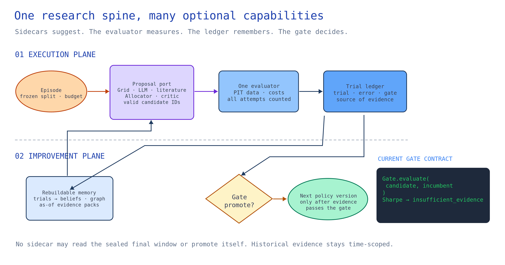

# AgentQuant

**A reproducible, failure-aware harness for research agents.** AgentQuant lets an agent propose experiments, test them under a fixed budget, inspect failures, and compare changes to its own research policy. Quantitative strategies are the first testbed.

The goal is to answer a specific question: **does evidence from earlier experiments help the agent choose better next experiments on unseen episodes, at the same cost?** A changed prompt or a higher in-sample score alone is not self-improvement.

## Try it locally

```bash
python -m venv .venv
source .venv/bin/activate
python -m pip install -e ".[dev]"
python run_app.py
```

This zero-key demo uses deterministic synthetic prices and a grid/random fallback. It checks that the loop runs and produces a report in `results/`; it does not measure trading performance. For the optional dashboard, install `.[ui]` and run `python run_app.py --app`. LLM-guided proposals and web research require `.[llm]` and provider credentials.

## How it works



[Edit the diagram in Excalidraw](docs/diagrams/research_harness.excalidraw).

- **Search:** a bounded loop proposes strategy candidates, applies one backtest evaluator with costs, and records failed as well as successful attempts.
- **Memory:** SQLite stores trials and retrieves evidence available by the market-time cutoff. A temporal evidence graph is an experimental, rebuildable projection for relationship-based discovery.
- **Policy improvement:** an outer loop can propose changes to the research process. A candidate must clear protected and statistical evaluation before promotion. The standalone search-aware gate is a foundation; validated Sharpe inference and full application integration remain [open work](https://github.com/OnePunchMonk/AgentQuant/issues/48).
- **Replay:** manifests, episode bundles, traces, and research memos make decisions inspectable. See the [architecture and implementation handoff](docs/AGENTQUANT_HARNESS_ARCHITECTURE.md) for current wiring and remaining work.

## Reproduce development comparisons

```bash
python scripts/fair_search_benchmark.py --episodes 3 --seeds 7 11 19 \
  --output results/fair_search_benchmark.json
python scripts/bounded_self_improvement.py --episodes 6 --seeds 7 11 19 \
  --n-mutations 3 --output results/bounded_self_improvement.json
python scripts/export_research_memo.py --episodes 6 --seeds 7 11 19 \
  --n-mutations 3 --output results/research_memo
```

These default to synthetic fixtures. In offline fallback mode, prompt mutation does not reach an LLM; identical mutation-arm results cannot support an evidence-guided improvement claim. The live comparison in [#31](https://github.com/OnePunchMonk/AgentQuant/issues/31), statistical work in [#48](https://github.com/OnePunchMonk/AgentQuant/issues/48), and prospective evaluation are still required.

| Evidence tier | What it establishes |
|---|---|
| Synthetic fixture | Wiring, replay, and leakage tests; no strategy-quality claim |
| Historical held-out | A result on specified past windows, with search and evaluation separated |
| Prospective | Precommitted decisions graded after future observations arrive; planned |

## Explore the project

- [Architecture and agent implementation handoff](docs/AGENTQUANT_HARNESS_ARCHITECTURE.md)
- [Worked research loop](docs/SELF_IMPROVING_SEARCH.md) and [memory design](docs/MEMORY_LAYER_DESIGN.md)
- [Experimental details](docs/EXPERIMENTAL_DETAILS.md) and [research memo design](https://github.com/OnePunchMonk/AgentQuant/issues/32)
- [Harnesskit trace integration](https://github.com/OnePunchMonk/harnesskit) and [Peek leakage auditor](https://github.com/OnePunchMonk/peek)
- [Contributing](CONTRIBUTING.md), [roadmap](ROADMAP.md), and [open issues](https://github.com/OnePunchMonk/AgentQuant/issues)

Backtests are research measurements, not predictions of future returns. The repository does not claim a profitable strategy or validated autonomous self-improvement. License: [MIT](LICENSE).
