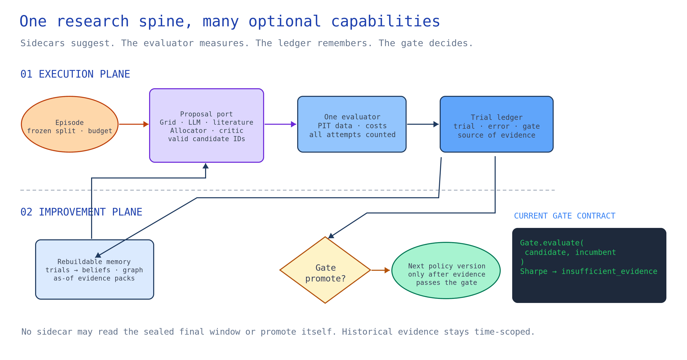

# AgentQuant harness architecture and implementation handoff

**Audience:** coding agents implementing the next research-harness milestones.  
**Purpose:** describe the repository as it exists, the target boundaries, and a dependency-ordered plan with falsifiable acceptance criteria.  
**Status:** implementation handoff, updated against the current code. It does not report new experiments or claim that open-issue work is complete.

## 1. Scope and evidence discipline

This handoff consolidates the work represented by issues #28, #31, #32, #38, #41, #43, #45 and #48. Read the current implementation and issue descriptions before changing behavior: the repository has moved beyond the original issue proposals in several places. In particular, #45 has a partial standalone foundation, #43 has a non-learning shadow sidecar, and #38/#41 have a functioning SQLite memory service and dream process. These are not reasons to treat integration or evaluation as finished.

Use three evidence tiers consistently:

| Tier | Meaning | Allowed claim |
|---|---|---|
| `fixture` | Deterministic synthetic or hand-built fixture | Wiring, invariants, repeatability on that fixture |
| `measured_historical` | Frozen historical market data with recorded provenance and exact split | Descriptive historical result under the named protocol |
| `prospective` | Decisions committed before the measured future window | Forward evidence for that protocol and period |

`unverified` is appropriate when provenance or evaluation is missing. A fixture result is never a historical or prospective result. A passing unit test is evidence of an invariant, not evidence of predictive utility. Every report must retain missing outcomes as missing, failed attempts in denominators, and the exact source, split, config hash, budget, and evaluator version.

## 2. Current-state audit

### 2.1 Existing runtime and evaluation

- `src/agent/agent_graph.py` implements the bounded analyze/propose/backtest/reflect/store loop. Candidate parameters are checked against strategy grids; the graph has explicit run statuses, run manifests, and a single holdout evaluation path.
- `src/agent/episode_splits.py` creates chronological development/holdout episodes and applies a uniform fixed-bps turnover cost in the experiment suite. The synthetic generator is deterministic. The persisted split JSON is important experimental input and must be versioned or content-hashed in reports.
- `src/agent/search_arms.py` and `scripts/fair_search_benchmark.py` compare fixed, search, frozen-agent, memory, and mutation arms. The offline FallbackPlanner does not consume prompt mutations. The report explicitly documents that mutation arms collapse to identical behavior offline; a meaningful diagnosis-vs-random comparison requires a live proposal backend and must fail closed when `--live` credentials are missing.
- `src/agent/policy_mutation.py` has a bounded prompt-policy mutation loop, deterministic diagnosis-tag-to-patch mapping, random mutation control, a protected-episode regression guard, and `FinalHoldoutGuard`. The fixed epsilon promotion rule has been removed in favor of a gate-backed, fail-closed comparison. Sharpe remains unpromotable until validated DSR exists. A candidate selection or promotion is not itself proof of general improvement.
- `src/agent/harness_config.py` contains historical harness knobs, but runtime checks reject unsupported knobs rather than silently accepting them. Do not infer runtime capability from config fields or epoch labels.
- Existing generic `scripts/reproducible_benchmark.py` and older harness optimizer scripts have synthetic/mock-fitness uses. Do not mix their numbers with backtest evidence.

### 2.2 Memory and idea-generation sidecar

- `src/memory/` provides `MemoryService`, trial/note records, beliefs, as-of filtering, OOS visibility rules, memory packs, read snapshots, and an offline `src/memory/dream.py` consolidation/replay process. The service is used by the agent and swarm, while legacy stores are still dual-written/read by some UI and CLI surfaces. See `docs/MEMORY_LAYER_DESIGN.md` for details and deferred items.
- Memory is primarily relational/episodic today: trials and notes are keyed and queried in SQLite. `src/memory/graph.py` provides a deterministic, rebuildable **in-memory projection** (`EvidenceGraph`) with typed nodes/edges, record provenance, contradiction links, and separate market/knowledge cutoffs. `MemoryService.graph_search` exposes an opt-in search view; the default prompt pack is still the existing belief retrieval. Existing links such as `hypothesis_id`, `run_id`, `config_key`, and read snapshots remain the durable source records.
- `src/agent/idea_sidecar.py` (issue #43 milestone 1) defines versioned Observation, Candidate/Action, Budget and Reward schemas; candidate actions are canonical-grid points; dev-only observations filter failures by decision time; holdout reward is attached only after trajectory closure. Its policies are fixed heuristic/seeded-random replay policies. The module explicitly has no RL/model and no new dependency. Feature flag: `AGENTQUANT_IDEA_SIDECAR`.
- The sidecar ranks/selects from a candidate space; canonical search/backtest code still owns evaluation. It does not emit code, bypass quality gates, or establish the value of learning.
- `src/agent/sidecar_tools.py` is an assistant-facing, allowlisted registry for bounded advisory calls. `src/agent/memory_tool.py` is a read-only graph-memory tool with explicit market cutoff and knowledge cutoff; `src/agent/hyde_retrieval.py` is a small offline #23 prototype with injected generation, temporal evidence retrieval, and canonical-grid mapping. Its lexical fallback and fixture tests do not satisfy #23's embedding, literature, or comparative-performance criteria. These adapters are not yet the default agent orchestrator.

### 2.3 Promotion gate

- `gate/` is a separately installable numpy-only package with a JSONL hash-chained trial ledger, initial gate API, prospective commitment validation and forecast scoring. The root package includes it and the bounded policy mutation path now calls it. It remains a **partial implementation** of #45: other application paths, validated search correction, ledger authority, and prospective grading remain open.
- Sharpe comparisons intentionally return `insufficient_evidence` pending a validated Deflated Sharpe Ratio implementation. Hash chaining detects edits relative to a trusted checkpoint; a party able to rewrite and rehash the full ledger can evade detection unless the head hash is anchored externally.
- Issue #48 tracks statistical validation, AgentQuant integration, adapters, null/power simulations and prospective evaluation. Do not remove conservative abstention to make a promotion succeed.

### 2.4 Known gaps reflected in repo docs/tests

- #28 orders credible bounded research and sealed evaluation before prospective/live paper-trading work. Prospective operation remains out of scope until controls and protocol are stable.
- #31 asks to prove diagnosis-driven mutation differs from random prompt search. Current offline arms necessarily collapse; live backend behavior and adequate paired evidence remain unproven.
- #32 asks for portable, rerunnable experiment bundles. Current memo generation supports fresh runs; replay from a manifest is deferred because episode-level results are not yet persisted as a stable standalone artifact.
- #38/#41 work has shipped meaningful memory and consolidation foundations, but docs identify remaining memory benchmark arms/config wiring, store cleanup, broader OOS ingestion and empirical memory benefit as incomplete.
- #43 is an interface/shadow milestone, not an RL implementation or efficacy result.
- The RRSI-inspired edit-descriptor preflight in `src/agent/evolution_regularizer.py` does not edit or promote a harness. Its sparsity, novelty, leakage-marker, and cost/noise rules require ablation and out-of-domain evaluation before use as a selection policy.
- #45/#48 gate work is partial. Bounded policy promotion records its candidate family in a durable ledger and abstains for Sharpe; the core agent's `reflect_node` quality threshold and legacy memory writes remain distinct, and the final holdout guard is still a resettable file. Do not call this full gate integration.

## 3. Target high-level design

Keep the runtime research loop small and deterministic at its trust boundaries. Sidecars may propose candidate actions or consolidate evidence, but they do not own backtesting, holdout access, or promotion.



[Edit the diagram in Excalidraw](diagrams/research_harness.excalidraw). The diagram shows the current bounded gate separately from the target architecture; sealed final grading remains a planned trust boundary.

### Component responsibilities

1. **Data/split layer:** loads immutable input references, creates or loads chronological partitions, computes content hashes, and enforces the visibility window. Holdout/final data is not passed to proposal policy or validation selector.
2. **Observation builder:** emits only data and evidence available at `decision_time`; missing or future timestamps fail closed. Includes schema and feature versions.
3. **Proposal policy:** receives an observation plus fixed resource budget and returns typed actions. Heuristic, random, shuffled-evidence control, LLM, or future learned policy implement the same interface.
4. **Action validator:** enforces canonical grid membership, uniqueness rules, allowed action source, budget, and no executable code. Invalid action aborts or is counted as a failed proposal; it is never silently repaired into a valid action.
5. **Evaluator:** one code path and cost model across arms; dev results can inform selection, validation can decide promotion, sealed final results are grading-only and single-use.
6. **Evidence store:** preserves raw proposals, outcomes, forecasts, claims, evaluations, policy/config versions, lineage and visibility dates. Derived beliefs can be recomputed from raw evidence.
7. **Gate:** consumes a complete trial bundle and returns `promote`, `reject`, or `insufficient_evidence` with reasons. It may only operate on declared validation evidence for selection and one sealed final report for grading.
8. **Consolidator:** offline and idempotent; adds derived summaries/edges, never rewrites raw evidence. It cannot create evidence or change past decisions.
9. **Bundle exporter/replayer:** exports all inputs required to reproduce an experiment without rerunning a model call. Replay validates hashes and reports any unavailable external dependency as unavailable.

### Control plane, execution plane and event plane

Do not let each sidecar invent its own loop. The **control plane** resolves the immutable `HarnessConfig`, registered capabilities, resource budget and versioned episode. The **execution plane** owns the one proposal/evaluation loop and sealed split boundary. The **event plane** records attempts, errors, reads and decisions, then produces memory projections and reports. `src/agent/capabilities.py` is the initial typed boundary for providers, allocators, analysts, observers and policy optimizers; it is a contract scaffold, not yet the default orchestrator. Before replacing an existing call path, adapt one real provider through it and prove parity against the prior path.

| Capability | Input | Output | Authority and failure behavior | Current adapter / next step |
|---|---|---|---|---|
| Proposal provider | Read-only `RunContext`, visible regime and memory pack, remaining proposal budget | Candidate specs with source and prompt/tool trace | May suggest; invalid or unavailable is an accounted attempt | Wrap `ProposalGenerator`, grid and tool orchestrator behind one port |
| Allocator / idea sidecar | Dev-only observation, valid candidate menu, remaining backtest budget | Ordered candidate IDs or source allocations | Cannot emit signals, holdout values or unbounded code | Adapt the shadow heuristic and random policy in `idea_sidecar.py`; later compare a learned policy |
| Literature/research provider | Frozen corpus snapshot and permitted external tools | Source-linked hypothesis candidates | Citations are context, not empirical evidence of returns; failures counted | Wrap `src/agent/tools/` and `hypothesis_generator.py`; no independent backtest |
| Critic / diagnosis provider | Candidate result and visible failure history | Structured diagnosis and counterfactual suggestion | Cannot change result, cost, or promotion status | Normalize existing reflection/failure records; test reason-to-patch causality |
| Memory consolidator | Completed, timestamped trials and notes | Derived beliefs and proposed links with source IDs | Append derived interpretation only; no raw result mutation | Extend `src/memory/dream.py`; dedupe and review before serving |
| Graph retriever | Scoped query, market cutoff, optional knowledge cutoff and token budget | Evidence paths with supporting and contradicting source IDs | Read-only projection; never infer a market fact from graph proximity | `MemoryService.graph_search` is opt-in; benchmark before using in proposal prompts |
| Policy optimizer | Completed episode reports and declared mutation space | Candidate harness configs with parent hash | Cannot promote itself or read sealed final outcomes | Adapt `policy_mutation.py`; keep random/shuffled controls in same space |
| Gate | Complete candidate family and paired validation/protected scores | Tri-state decision and reason | Sole authority for policy promotion; missing/unsupported evidence abstains | Finish #48 statistics and all call-site integration |
| Observer/exporter | Immutable events and completed ledger | Trace, dashboard, Harnesskit trajectory, memo | Telemetry only; failure cannot alter experiment result | Route `trace.py`, bridge and report renderers to shared events |

The current registry does not enforce OS-level isolation or a real runtime budget. Proposal counts in typed requests are validation hints, not a substitute for an orchestrator-owned counter. Treat those as implementation work, not existing guarantees.

### Ownership and sidecar lifecycle

One owner controls each boundary: `EpisodeRunner` schedules, the common evaluator computes, the ledger records, `MemoryService` retrieves, and the gate promotes. Sidecars can be in-process adapters, sandboxed workers, or scheduled jobs; deployment is independent of their role. Each receives a versioned schema, an allowlist of inputs, a deadline/cost ceiling, and a failure policy. Their output enters the shared attempt record. Observers get immutable snapshots and cannot return decisions. Disable one sidecar without changing the experiment identity or silently substituting a different policy; record effective configuration and fallback explicitly.

## 3A. What would actually make this self-improving?

There are **four separate claims**; do not collapse them into one label:

1. **Stateful search:** visible prior trials change the next proposal. Mechanism test: same episode and seed with memory on/off produces a traceable action difference. This proves use of memory, not benefit.
2. **Evidence-conditioned adaptation:** a diagnosed failure maps to a justified patch, and shuffling the diagnosis across episodes changes the patch. This proves the evidence enters the mechanism. #31 tests whether the change improves held-out utility over random and shuffled controls.
3. **Policy improvement:** the outer loop changes a versioned harness policy, evaluates all attempted variants under a fixed budget, passes a search-aware gate on independent validation/protected episodes, and freezes the winner for a once-only final grade. Current Sharpe gate intentionally abstains; therefore automatic policy improvement is **not yet demonstrated**.
4. **Transfer/generalization:** a frozen improved research policy chooses better experiments on later periods, new assets/strategy families or another domain. This is the strongest claim, and requires prospective or untouched transfer evidence.

For every claimed improvement, publish `(parent_policy_hash, candidate_policy_hash, exact changed settings, evidence_ids_used, candidate family size, budget spent, matched episode/seed outcomes, gate decision, sealed outcome)`. If a more complex agent only uses extra proposals, if shuffled evidence works equally well, or if final outcomes revert to the incumbent, the corresponding causal story is falsified. Offline fallback prompt arms cannot establish evidence-conditioned prompt improvement because the backend does not consume the prompt.

### Diffusion and SGLang Diffusion transfers to test, not assume

| Source idea | Proposed harness component | Controlled comparison |
|---|---|---|
| Denoising schedule / adaptive steps | Budget allocator switches from broad exploration to local refinement to independent confirmation as uncertainty changes | Fixed equal-step allocation vs adaptive allocation at matched backtest and token budgets |
| Classifier-free guidance | Score proposals with and without retrieved evidence; tune evidence weight while measuring diversity | No memory, real memory, shuffled memory; quality and candidate diversity |
| Image editing strength / inversion | Mutate a prior candidate by bounded semantic distance, retaining lineage and unchanged features | Local edits vs fresh proposals, matched attempts and inherited evidence |
| Best-of-N sampling and reranking | Diverse providers propose candidates; common validator/evaluator selects | One provider vs mixture under equal total budget; account for selection bias |
| Consistency distillation | Distill expensive agent trajectories into a cheap proposal ranker | Frozen teacher vs distilled ranker quality per dollar on untouched episodes |
| Post-training on preferences or delayed reward | Train the idea allocator on paired research trajectories, using future held-out quality and cost only as delayed labels | Shadow heuristic and random baselines; off-policy overlap checks before any RL promotion |
| SGLang-style pipeline components | Typed provider/evaluator/observer interfaces and effective config; reject unsupported combinations | Adapter parity and fail-closed behavior tests |
| SGLang-style batching/caching | Content-addressed feature cache and deduplicated backtest jobs keyed by data, evaluator, strategy and cost hashes | Identical metrics with and without cache; wall-time/cost reduction measured separately |

These are architecture analogies. Do not import image quality losses, diffusion samplers, or GPU batching code into finance evaluation. In particular, cached outcomes must never let a historical run retrieve a result that was unavailable at its decision point.

## 4. Low-level contracts

The assistant-facing tool registry, HyDE retrieval prototype, and graph-memory adapter are documented in [ASSISTANT_TOOL_CONTRACT.md](ASSISTANT_TOOL_CONTRACT.md), [HYDE_RETRIEVAL.md](HYDE_RETRIEVAL.md), and [RRSI_INTEGRATION.md](RRSI_INTEGRATION.md). Their presence does not complete issue #23's embedding, literature, or comparative validation criteria, nor #43's learned RL policy.

The next offline slice adds an [assistant tool runner](ASSISTANT_TOOL_RUNNER.md), a [non-learning RL shadow advisory tool](RL_SHADOW_TOOL.md), a [synthetic #23 retrieval comparison](HYDE_BENCHMARK.md), a [versioned benchmark suite contract](BENCHMARK_EVOLUTION.md), a [communication-format experiment](COMMUNICATION_EXPERIMENT.md), and a [diffusion-inspired proposal-refinement toy](PROPOSAL_REFINEMENT.md). These are integration and mechanism checks. The communication microbenchmark uses a token proxy and local serialization latency, not model tokens or end-to-end task quality. The #23 comparison scores fixture relevance without backtesting; the refinement toy's equal-call baseline reaches the same score. None is evidence of market benefit or automatic self-improvement.

The following are target contracts. Preserve backward compatibility where feasible; version persisted schemas and report clear migrations.

### 4.1 Sidecar proposal contract (#43)

Canonical source remains `src/agent/idea_sidecar.py`; avoid creating a second competing action schema. Define protocol equivalents in that module or a nearby versioned module:

```python
class ProposalPolicy(Protocol):
    def propose(self, observation: Observation, candidates: Sequence[Candidate],
                budget: Budget) -> Sequence[Action]: ...

class Evaluator(Protocol):
    def evaluate_dev(self, episode_id: str, actions: Sequence[Action]) -> Sequence[Outcome]: ...
```

Required fields and invariants:

- `Observation`: `schema_version`, `episode_id`, `decision_time`, monotonically increasing `step`, asset/strategy/regime scope, canonical grid fingerprint, visible trial/failure ids with source timestamps, tried action ids, remaining proposal/tool/time budgets, and observation hash.
- `Action`: `action_id`, `source`, canonical `grid_index` and exact params, `propensity` or explicit `null` when not defined, `policy_id`, observation hash, and step. Never accept params that are not exactly a canonical grid point.
- `Trajectory`: ordered observations/actions/dev outcomes, policy/config/model/provider identifiers where applicable, budget accounting, seed, and terminal status. Holdout values are structurally excluded until trajectory closure.
- `Outcome`: status, separately recorded cost-adjusted return, drawdown, turnover and other declared metrics; failed/missing is distinct from numeric zero.
- `RewardSpec`: preregistered versioned formula; retain components and raw metric values. Do not tune reward weights on final holdout.

The sidecar must be opt-in and advisory. Feature flag off must leave default import/runtime behavior unchanged. Sidecar exceptions, exhausted budget, invalid action, and no candidate must be explicit outcomes. Never write sidecar reward or unsealed outcome into the same observation that produced the action.

### 4.2 Evidence graph over the existing SQLite store (#38/#41)

Extend `src/memory/graph.py`'s typed, provenance-first projection using existing SQLite as the source of truth; do not add a graph database as a prerequisite. Current nodes/edges are rebuilt from `Trial` and `Note` records, deterministically keyed, and include known-time/data-time/OOS visibility fields. Keep `mem_trials`, `mem_notes`, `mem_reads` and their visibility rules authoritative. First integrate and measure bounded graph retrieval from these projections. Add versioned durable edge storage only if a demonstrated query or lineage requirement cannot be met by rebuilding from source records:

```sql
CREATE TABLE mem_edges (
  edge_id TEXT PRIMARY KEY,
  src_type TEXT NOT NULL, src_id TEXT NOT NULL,
  relation TEXT NOT NULL,
  dst_type TEXT NOT NULL, dst_id TEXT NOT NULL,
  created_at TEXT NOT NULL,
  data_end TEXT,
  provenance_json TEXT NOT NULL DEFAULT '{}',
  UNIQUE(src_type, src_id, relation, dst_type, dst_id)
);
CREATE INDEX ix_mem_edges_src ON mem_edges(src_type, src_id, relation);
CREATE INDEX ix_mem_edges_dst ON mem_edges(dst_type, dst_id, relation);
```

Allowed first-pass node types: `run`, `episode`, `policy`, `config`, `trial`, `hypothesis`, `claim`, `evaluation`, `note`, `bundle`, `dataset`, `split`, `sidecar_trajectory`. Allowed relations are a closed enum, e.g. `generated_by`, `evaluated_on`, `derived_from`, `supports`, `contradicts`, `retrieved_for`, `selected_over`, `promoted_from`, `exported_as`.

Rules:

- Edge creation is deterministic/idempotent; a dangling target is rejected.
- Every derived node/edge carries source ids and the latest market-time `data_end` used; temporal recall filters edges and nodes by the same `as_of` contract as trials.
- Do not represent `supports` or `contradicts` as truth. They are attributable relations with evidence ids, evaluator, and timestamp.
- A belief is a query-time projection over trials, not a new independent observation. Store derived belief snapshot hashes and algorithm version if needed for reproducibility.
- Keep stable identifiers separate from display labels. Avoid free-form graph traversal in prompts; retrieve bounded, typed neighborhoods under token and row limits.
- SQLite schema migration must preserve current databases and existing as-of leakage guarantees. No silent destructive rebuild.

The current projection already links trials to strategy, asset, config, regime, and claim nodes, and notes to their declared entities/claims. It preserves contradictory assertions rather than collapsing them. Remaining graph work is to validate edge-case visibility, connect additional persisted lineage (policy, run, episode, data/split, memory snapshot, bundle) where source records exist, and expose bounded retrieval through `MemoryService` without weakening its SQL `as_of` guarantees. A useful query is: for a config/policy, return prior trials and OOS evaluations, the hypothesis/claim that motivated them, the policy that generated them, and the exact memory snapshot visible at decision time. This enables audit and portable replay without claiming graph-based learning.

### 4.3 Evidence bundle / memo contract (#32)

Create a versioned bundle from an already completed run, rather than making memo text the source of truth. Minimum manifest:

```json
{
  "schema_version": "1.0.0",
  "run_id": "...",
  "evidence_tier": "fixture|measured_historical|prospective|unverified",
  "code_revision": "...",
  "policy_hash": "...",
  "evaluator_version": "...",
  "dataset": {"uri_or_inline": "...", "sha256": "...", "adjustment": "..."},
  "splits": {"path_or_inline": "...", "sha256": "..."},
  "seed": 0,
  "budget": {},
  "artifacts": [],
  "decision": {"status": "...", "reasons": []}
}
```

Bundle includes raw trajectory, all candidate attempts, outcomes, memory snapshot/served ids, policy before/after, promotion decision inputs, evaluation report, generated memo, and dependency/runtime metadata. Secrets, API keys, and private credentials must never be included. A replay mode loads only a bundle and local declared inputs; it makes no network/model call unless explicitly requested and must distinguish deterministic replay from rerun. Missing data is a hard incomplete status, not a substitute series.

### 4.4 Gate contract (#45/#48)

Maintain `gate/` as separately installable. Add only framework-neutral primitives there; add AgentQuant mapping in `src/integrations/` or a focused adapter.

- Ledger trial record binds canonical candidate/config, parent policy id, hypothesis id, data/split hashes, seed, budget, code/evaluator versions, outcome status and all metric components.
- Hash-chain verification must support checkpoint head export/import. Document external anchoring; do not call a locally rehashed chain tamper-proof.
- Gate result is tri-state `promote | reject | insufficient_evidence`, with machine-readable reason codes. Missing data, bad coverage, unverified provenance, unsupported metric, or insufficient power yields `insufficient_evidence`.
- Numerical Sharpe promotion remains disabled until the DSR implementation passes independent reference tests and null simulations across search counts/correlations. No naïve count-only correction may be labeled DSR.
- The preliminary non-Sharpe bootstrap pairs score arrays by position; it does not verify episode/seed identities or cluster overlapping market windows. Before using it to promote a real policy, consume explicit matched keys, declare the independent sampling unit, and validate false-promotion behavior under dependence. Merely storing `validation_keys` alongside scores does not make the estimator valid.
- Prospectively declared claims use the existing commitment/forecast concepts: commit before reveal, immutable commitment identity, score only after reveal, report coverage, interval score and Brier separately. No backfill of forecasts after observing the outcome.
- Application promotion must call the gate adapter; no second ad-hoc promotion rule may bypass it. Preserve current `FinalHoldoutGuard` and do not use final outcomes in candidate selection.

### 4.5 Falsifiable self-improvement mechanism (#28/#31)

Self-improvement means the policy changes proposal choices in a way that improves preregistered held-out research utility under the same budget, against controls. A changed config, better dev score, selected winner, or successful code path is not the endpoint.

Primary hypothesis for #31: **diagnosis-conditioned mutation improves held-out utility per fixed proposal budget over both random mutation and shuffled-evidence mutation**.

Protocol:

1. Freeze the candidate patch pool, diagnosis taxonomy, diagnosis→patch map, mutation budget, evaluator/cost model, datasets and split manifest before scoring.
2. Compare at least `evidence_conditioned_mutation`, `random_mutation`, `shuffled_evidence_mutation`, and `frozen_agent` on identical episode×seed pairs. The shuffled control preserves the number/type of diagnosis records but permutes their association with episodes, testing whether the specific evidence-to-patch mapping matters.
3. All arms receive equal proposal, model/tool-call, and wall-time budgets (or clearly report the dimensions that cannot be equalized). Record failed calls and no-op mutations; count in all resource and success denominators.
4. Choose/promote only on development/validation windows. A protected episode checks regression but is not repeatedly retuned. Seal final episodes, run each finalist once, and do not use them to revise the pool or thresholds.
5. Primary metric: paired difference in net held-out utility per attempted proposal, with utility formula preregistered and raw net return, max drawdown, turnover, failure rate and candidate count reported separately. Analyze episode-seed paired deltas and confidence intervals; include effective sample count and missing pairs.
6. Falsifier: if conditioned mutation does not beat both controls by the preregistered minimum effect, or uncertainty includes no meaningful gain, report no demonstrated benefit. If shuffled evidence performs similarly, evidence attribution mechanism is unsupported. If only validation gains appear without final confirmation, report selection overfit.

Current limitation: the offline fallback does not read the mutated prompt, so it cannot test this hypothesis. An offline arm that collapses is a wiring test only. Live LLM trials add stochasticity/provider drift; log model identifier, exact prompt hash, raw response where permitted, parse failures, retries and cost. Repeat over multiple seeds and time blocks. No numerical effect size is claimed by this document.

## 5. Benchmark and validation plan

### Evolving the benchmark itself

Version the episode manifest, evaluator, metric definitions, data cutoff, tool inventory, and communication schema together. Keep an immutable core for longitudinal comparison and add challenge sets from observed failures only in the next benchmark version; a newly added case is never retroactively part of an earlier claim. Partition by chronology and task family, with development, selection, sealed final, and later prospective cohorts. Report paired episode-level outcomes and confidence intervals, search count, token/tool/wall budgets, replay fidelity, and protected-regression slices. Repeated seeds on one market path are not independent markets.

For each new sidecar/tool, use a factorial ablation: fixed tool set versus learned selection; memory graph versus flat retrieval versus no memory; HyDE versus literature/grid controls; full action-state messages versus compact typed envelopes; and regularized versus unrestricted harness edits. Freeze the protocol before seeing final outcomes. Add planted-signal and null controls, counterfactual/shuffled evidence, stale/contradictory memory, malformed tool output, provider drift, and out-of-domain episodes. Promote a benchmark revision after review, then treat its final set as sealed for the next method comparison. See the [assistant tool contract](ASSISTANT_TOOL_CONTRACT.md) and [RRSI integration](RRSI_INTEGRATION.md) for the individual experiments.

The current [suite contract](BENCHMARK_EVOLUTION.md) hashes manifests, appends new episodes under a parent hash, and checks declared budgets and partitions. It does not enforce sealed data access at runtime. The fair-search development report now resamples whole episodes for paired confidence intervals, since seeds on the same episode are correlated; fewer than five paired episodes yield no interval.

### Phase A: invariant tests (no utility claims)

- temporal leakage property tests for observation, memory, graph edges and sealed holdout;
- invalid/out-of-grid action rejection; budget cannot be exceeded;
- idempotent edge and ledger writes; schema migration on a populated old DB;
- deterministic replay from a bundle with model call disabled;
- final-holdout one-shot behavior and proof that no selector sees final outcomes;
- null/missing/error preservation; failed proposals remain in denominators;
- independent tests for ledger corruption, checkpoint anchoring semantics and gate abstention.

### Phase B: controlled fixture benchmark

Use deterministic synthetic fixtures to validate arm plumbing and diagnostic power. Add null environments where evidence labels are randomized and a signal environment with a known planted mapping. Expected behavior: on null, diagnosis-conditioned policy should not systematically beat shuffled/random; on planted mapping, the test should detect whether the policy uses the association. This validates mechanism sensitivity, not market usefulness. Run multiple seeds and retain every pair.

### Phase C: frozen historical benchmark

Before execution, commit dataset hashes/provenance, adjustment convention, split dates, costs, arm definitions, budget, primary endpoint, minimum effect, statistical procedure and exclusion rules. Use rolling, non-overlapping chronological blocks; no split may be changed after viewing arm outcomes. Include simple baselines and the mutation controls. Report per-episode data and paired distributions, not only means. Correct for the planned comparison family and repeated looks; do not select one favorable asset/window after the fact.

For issue #38/#41 memory, include `frozen_agent`, `frozen_agent_memory` and a no-seed/context-only ablation when wired. Separate retrieval context value from seed reuse. Track future-dated memory sentinels, repeat rate on visible `avoid/decays` configs, IS–OOS gap, utility and failure count. Memory utility is unproven until these comparisons complete.

### Phase D: prospective commitment (after #28 prerequisites)

Only after gate integration and protocol review: commit policy hash, forecast/decision, time, data cutoff, budget, evaluator, confidence/interval and ledger checkpoint before each future window. Reveal/score after the window closes. Report all commits, including abandoned/invalid runs, coverage, proper score and realized metrics. Initially paper/research only. Any live execution request requires a separate risk, order, broker, capital and operational design; this architecture does not authorize it.

### Statistical reporting requirements

- Predeclare one primary endpoint and minimum effect; all other metrics are secondary.
- Pair results on exact episode and seed; state paired estimator, interval method, multiplicity treatment, and assumptions.
- Include the number of independent time blocks; seeds on the same market path do not create independent market evidence.
- Show raw per-pair values and missingness. Avoid treating repeated overlapping windows as independent.
- Use null and planted-signal simulation for gate calibration; estimate false promotion rate and power over effect sizes before enabling automatic promotion.
- A positive benchmark supports only the tested assets, period, cost model, policy family and protocol. It does not establish profitability or future performance.

## 6. Dependency-ordered implementation work packages

Packages are intentionally serial where contracts or storage schemas are shared. A coding coordinator may delegate disjoint files in parallel after an interface is frozen, then integrate and test the combined tree. The user has authorized a direct `main` push for this work; verify the target head and checks before updating it. Do not mark a future experiment complete when only its code is written.

| Order | Work package | Main files | Depends on | Exit artifact |
|---|---|---|---|---|
| 0 | Freeze architecture/API and record current baseline limitations | This doc, issue tracker | None | Versioned plan and explicit limitations; initial draft present |
| 1 | Persist stable run/episode outcomes and manifest-complete artifacts for replay | `src/agent/episode_bundle.py`, `episode_report.py`, `run_manifest.py`, scripts | 0 | Bundle export/load contract and fresh-run parity |
| 2 | Wire sidecar capability interfaces and trajectory metadata without learning | `src/agent/capabilities.py`, `idea_sidecar.py`, runner, tests | 0 | Typed contracts are present; real provider adapter, effective config and replay parity still needed |
| 2a | Register assistant-facing advisory tools for idea, #23 hypothesis retrieval and graph memory | `src/agent/sidecar_tools.py`, `hyde_retrieval.py`, `memory_tool.py`, tests | 2, 3 for durable memory | Bounded adapters present; live assistant routing, embedding/literature retrieval and outcome comparison still needed |
| 3 | Expand graph memory retrieval and persisted lineage | `src/memory/graph.py`, `service.py`, models, tests | 0 | Opt-in temporal graph search present; lineage and retrieval benchmark still needed |
| 4 | Implement bundle replay and memo regeneration from persisted artifacts | `src/agent/research_memo.py`, `scripts/export_research_memo.py` | 1 | Replay command verifies hashes; no hidden model/network dependency |
| 5 | Gate validation: DSR reference implementation and null/power suite | `gate/`, `gate/tests/` | 0 | Correct known-vector scoring; calibrated tri-state abstention |
| 6 | Complete gate integration across promotion paths | `policy_mutation.py`, `agent_graph.py`, scripts, tests | 1, 5 | Bounded path now fails closed via gate and writes a family ledger; full ledger authority, validated Sharpe gate and remaining paths still needed |
| 7 | Controlled synthetic benchmark for self-improvement mechanism | `scripts/fair_search_benchmark.py`, fixtures/tests | 2, 6 | Null/planted signal controls behave as expected; diagnostic report |
| 8 | Frozen historical benchmark and memory ablations | benchmark scripts, protocol/results artifacts | 3, 6, 7 | Preregistered reproducible report; conclusions bounded to dataset |
| 8a | Compare compact communication, tool selection and RRSI edit regularization | `docs/ASSISTANT_TOOL_CONTRACT.md`, `docs/RRSI_INTEGRATION.md`, frozen benchmark artifacts | 2a, 8 | Paired cost/quality and out-of-domain ablations before integrating a learned selector or preflight gate |
| 9 | Prospective commitment/reveal workflow | `gate/`, integration, CLI/docs | 4, 5, 6, 8 and #28 review | Time-stamped ledger and first prospective scored cohort |

For each work package, assign one file owner and a review owner. The coordinator checks independent tests, full suite, lint, wheel/install and final diff, then makes one focused commit on the intended branch and pushes the expected `main` head. Avoid simultaneous edits to `src/memory/schema.py`, sidecar schema, or gate API until the preceding contract has landed. If `main` advances during work, fetch and integrate safely; never force-push.

**Suggested independent subagent lanes after the contracts freeze:** (A) evaluator/ledger and holdout guard; (B) proposal and allocator adapters; (C) memory graph, provenance and retrieval; (D) bundle/replay and observers; (E) benchmark fixtures and statistical calibration; (F) docs/onboarding. The coordinator owns cross-lane API changes, data migration, packaging, end-to-end validation and the final push. Each lane returns changed paths, exact checks, unresolved risks and a runnable acceptance example; no lane self-certifies a performance claim.

## 7. Exact acceptance criteria

### #28 — research roadmap / ordering

- No task in this plan adds broker execution or trades live capital.
- The benchmark protocol, leak protections, evidence tiers and reporting rules are checked into the repo before a prospective claim is made.
- Prospective work is gated on completed gate adapter, null/power tests, sealed historical comparison and explicit protocol review.
- All reports clearly distinguish development fixture, historical measurement and prospective evidence.

### #31 — diagnosis-driven mutation

- Live-mode request with missing credentials/provider fails before producing a benchmark report that could be mistaken for a valid comparison.
- Offline report labels the three mutation arms as collapsed/wiring-only and does not present their identical metrics as a successful comparison.
- On a planted synthetic mapping, conditioned policy beats shuffled-evidence control in the direction of the preregistered metric; on null/randomized evidence, no systematic advantage is observed within declared uncertainty.
- On historical data, same fixed budgets/splits are used and every paired episode×seed result plus failed attempt is exported. Positive wording is allowed only if primary endpoint passes the predeclared threshold and uncertainty/multiplicity criteria.
- Shuffling is performed deterministically from a recorded seed; it preserves the evidence distribution and changes only diagnosis-to-episode attribution.

### #32 — portable rerunnable bundles

- Exported bundle is self-describing, versioned, secret-free, includes exact data/split/code/evaluator/policy hashes and every candidate attempt/outcome/decision input.
- Replay from bundle verifies all hashes and reproduces deterministic decisions/metrics exactly within documented numeric tolerance without an LLM/network call.
- Missing artifacts or schema incompatibility produce explicit incomplete/error results; no silent fallback data is loaded.
- Memo generated from replay matches the stored structured decision and labels absent fields unavailable.

### #38/#41 — evidence memory and consolidation

- Current graph projection plus its tests preserve trial/note source ids, deterministic rebuilds, contradictory outcomes and OOS visibility; integration adds bounded queries under `as_of` without duplicating raw evidence.
- Any required schema migration preserves existing trials/notes; persisted edges are introduced only with a migration/idempotence rationale.
- Dream cycles are idempotent, offline, separately report phase errors and never alter raw historical trial/forecast records.
- Graph memory is an audit/retrieval feature until measured utility supports stronger claims.
- To claim memory benefit, paired historical benchmark reports context-vs-no-memory and seed-vs-no-seed ablations, with repeat rate, IS–OOS gap, utility and missingness.

### #43 — hypothesis-generation sidecar

- Sidecar disabled by default and imports no optional learning stack on default path.
- Observation cannot contain future/holdout values; action must be a canonical-grid point; trajectory logs schema, policy, observation hash, seed and budget use.
- Holdout reward is attached only after trajectory closure; final holdout remains one-shot.
- Fixed heuristic and seeded random policies replay identically for same inputs; no learning claim until a separate train/eval design is implemented.

### #45/#48 — gate foundation and follow-up

- Existing ledger detects mutation against trusted checkpoint and states the rehash limitation; checkpoint anchoring can be verified externally.
- Invalid provenance, insufficient evidence, incomplete paired data or underpowered comparison returns `insufficient_evidence` and never promotes.
- DSR implementation matches independently sourced reference vectors within declared tolerance and passes null simulation false-positive/power tests before enabling Sharpe-based automatic promotion.
- AgentQuant bounded promotion path persists full trial records and uses gate result as the sole promotion authority; regression and final-holdout guards remain active.
- Prospective claim commit is immutable and timestamped before reveal; each reveal scored once; no retrospective forecast creation or threshold editing.

## 8. Risks, decisions and long-term backlog

1. **LLM non-determinism and provider drift:** prompt hash alone is insufficient. Store provider/model/version, response metadata, attempts and cost; repeat paired runs; distinguish replay from rerun.
2. **Selection bias:** many assets, metrics, seeds, episodes, and repeated looks inflate false discoveries. Commit a primary endpoint and use null calibration and multiplicity controls.
3. **Market sample dependence:** multiple seeds over one synthetic or historical path do not imply many independent markets. Use distinct chronological blocks and limit claims.
4. **Data provenance/corporate actions:** freeze raw data hashes, source time, adjustments, survivorship choices, and timezone/calendar handling. Current synthetic fixtures cannot settle these issues.
5. **Memory feedback loops:** memory can concentrate search around previous winners, increase multiple-testing burden, or replay stale evidence. Keep all proposal lineage, deflate for search scope, expire/reweight evidence only through versioned algorithms.
6. **Graph schema creep:** retain relational source of truth and typed enum edges. Add vector/embedding search only after a measured retrieval need and a leakage-aware benchmark.
7. **Gate overconfidence:** DSR is not a universal correction for dependent strategies or flawed data. Abstention is a valid outcome; report assumptions and calibration limits.
8. **Prospective operational scope:** paper commitments are not an execution service. Broker integration, position sizing, intraday controls, kill switches, capital/risk limits, and audit/compliance are separate projects.
9. **Current release quality:** optional dependencies and external datasets can drift. Keep core fixture suite network-free; pin benchmark metadata; never make live data fetch success a prerequisite for basic CI.
10. **Long-term learning research:** only after the controls above, investigate contextual bandit/offline RL methods with action propensity, support/overlap diagnostics, off-policy estimator validity, conservative policy improvement, and independent final periods. A causal attribution story is needed before using “learned from evidence” language.

## 9. Maintainer handoff checklist

- Read implementation and tests before assuming this document matches every edge case; update the doc in the PR if a source contract has changed.
- Keep source evidence and derived summaries distinct.
- Add acceptance tests alongside each behavior change; do not start a benchmark until its protocol is frozen.
- Run tests/verification only for the assigned implementation package and report exact commands/results; this document itself reports none.
- Never publish a favorable number without the manifest, raw paired rows, evidence tier, and limitations.
- Close issues only when their acceptance criteria are met; merged scaffolding is not proof of empirical success.
