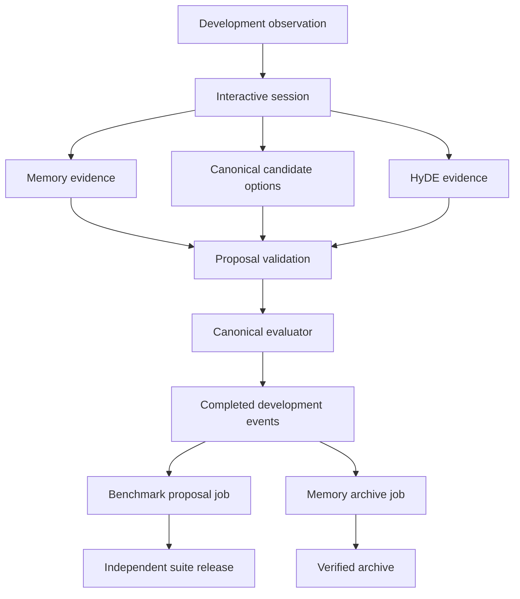

# Sidecar execution and optimization design

AgentQuant should have one advisory tool boundary and three execution lanes.
Interactive evidence retrieval belongs on the proposal path. Benchmark mining
and memory compaction belong after an episode or in maintenance jobs. All three
can reuse protocol, provenance, and artifact utilities; they must not share
authority, deadlines, or mutable run state.

This design is grounded in main at `a6ae7b2`. The session lifecycle changes
described below are implemented alongside this document. Remaining changes are
explicitly a migration plan, not claims of completed integration or speedups.

## Ownership and execution lanes

| Lane | Inputs | Output | Owner and timing | Forbidden authority |
|---|---|---|---|---|
| Interactive | Immutable development observation, canonical grid, dated evidence references | Ranked options and cited evidence | Proposal orchestrator, bounded per decision | Backtest, holdout access, promotion, memory writes |
| Benchmark | Completed development failure metadata and pinned anchor manifest | Hash-chained proposed challenge suite | Post-episode job | Reading sealed outcomes or installing its own suite |
| Memory | Consistent snapshot of trial/note records and retrieval probes | Verified archive and retention report | Maintenance job | Deleting canonical records or changing beliefs |

The diagram shows development execution only. Sealed grading stays outside
these lanes and is never a feedback source for sidecar proposals.

## Findings in the current implementation

1. `SidecarToolRegistry` stored counters and a creation-time deadline on the
   adapter registry. A reused `AssistantToolRunner` therefore inherited prior
   requests' exhaustion and idle time. A fresh per-run session now snapshots
   registrations and owns its counters, deadline, and lock. Direct registry
   calls deliberately retain per-instance limits. Do not reset a shared live
   registry: concurrent requests would reset one another's accounting.
2. Handlers received caller-owned argument objects after JSON validation.
   Dispatch now decodes the admitted JSON bytes, isolating nested mutations
   from the caller. Registration is a startup operation; sessions share handler
   services, not mutable request containers. Schema mappings remain trusted
   configuration and must not be mutated during request serving.
3. `ToolBudget` admitted fractional counts and non-finite deadlines. Counts now
   require non-negative integers and wall time requires a finite non-negative
   number. This prevents NaN from disabling comparisons.
4. `agent_graph._run_assistant_sidecar_context` constructs separate memory,
   idea, and HyDE registries with independent two-second limits each. The
   production aggregate therefore has no single two-second decision deadline.
   Its HyDE instance has empty evidence, and the idea observation supplies empty
   failures/tried indices. The wiring is advisory, but does not yet use the
   complete failure-aware observation.
5. The graph serializes full tool results into prompt context and slices the
   JSON string at 12,000 characters. This can break JSON, omit citations, and
   spend context on large option lists. The full trace and the prompt evidence
   view should be separate representations.
6. Benchmark mining and reversible compaction already have useful standalone
   boundaries. Wrapping either as a synchronous assistant tool would add
   latency and expand authority without improving the proposal decision.

## Interactive target

Build the adapter catalog once per worker. Open one session per proposal
decision, after building the dated observation and before tool selection. Set
an aggregate call/byte/deadline budget there. Budget includes selection and
validation time; provider clients must also have their own request timeouts.
Construct expensive services before request admission or explicitly charge
their initialization to the decision budget.

Use an explicit dependency plan: memory lookup and candidate classification
may run independently; evidence-based HyDE runs only when there is an actual
evidence corpus and a relevant request. The RL shadow adapter consumes the
validated candidate menu afterward. Start sequentially under one deadline;
introduce bounded parallel dispatch only after traces show an independent
critical-path benefit. More workers cannot compensate for duplicated work or
empty evidence.

The observation builder, rather than the LLM, supplies tried grid indices,
visible failures, asset, regime, and market/knowledge cutoffs. Backtest inputs
must still pass canonical action validation. An unavailable sidecar returns
an explicit failure/abstention; the canonical proposal path can continue.

Return a small prompt view containing source IDs, citations, canonical indices,
short rationales, status, and omission counts. Select complete items before
serialization until the byte budget fits. Keep source metadata with each item;
never truncate serialized JSON. Retain full validated results in the audit
artifact. Prefer selected options over sending the entire canonical grid back
to the planner.

No cross-request cache is implemented in this change. If added, cache only
read-only deterministic outputs keyed by adapter/version, normalized arguments,
both temporal cutoffs, snapshot identity, and corpus/grid hashes. Bound entries
and bytes, charge cache hits to output limits, and distinguish hit latency from
handler latency. Provider-generated hypotheses require provider/model/prompt
versions; an identical query alone is not a safe key.

## Background target

Emit a completed-development event with run/episode IDs, snapshot and split
hashes, failure source IDs, and schema version. Use a durable job identity based
on event content and worker version so retries do not append duplicates. Until
there is measured queue pressure, a local durable job table is sufficient; a
new message broker is unnecessary.

Benchmark jobs call `propose_next_suite` against a pinned anchor. Persist the
proposal, rejection reasons, source provenance, and parent hash. Suite release
must reject a stale parent after another proposal wins release. Compare systems
on the same frozen suite; report mined challenge scores separately from the
anchor so moving difficulty cannot masquerade as progress. Review status alone
does not prove reviewer independence: release authorization belongs to the
release service, not the sidecar's reviewer string.

Memory jobs use a consistent snapshot, run cutoff-aware relevance/citation/
decision probes, atomically archive, reload, and verify rollback. Existing
compaction is lossless archival, not semantic context compression. A future
graph summary should be a rebuildable retrieval index with source references;
raw evidence remains restorable. Deletion requires a separately implemented
retention protocol and durable verified source copy. Probe success describes
those probes, not universal future-query equivalence.

## Resource and failure contracts

In-process execution provides accounting and post-return overrun detection,
not hard interruption. Use provider timeouts for network tools and isolated
workers for potentially blocking workloads. The existing POSIX fork option is
useful for bounded local handlers; it is not a portable sandbox or a guarantee
that database/network clients can safely be inherited. Do not fork shared
clients from a multithreaded service without an explicit lifecycle design.

Record run/request ID, adapter version, observation/snapshot hash, cutoffs,
effective limits, selected tool, outcome, input/output byte counts, elapsed
time, and artifact hash. Full durable tool replay and these additional audit
fields remain migration work. Failed admitted calls consume call/input budget;
retries must use the remaining decision budget. Do not automatically retry
contract violations, forbidden capabilities, or exhausted limits.

## Migration and acceptance

| Step | Deliverable | Acceptance evidence |
|---|---|---|
| 1, implemented | Fresh runner session, strict limits, JSON argument snapshot | Reuse, concurrent-run, budget exhaustion, invalid-limit, mutation-isolation tests |
| 2 | Shared decision session in `agent_graph`, complete observation | Aggregate deadline/call bound across all adapters; tried candidates excluded; future evidence rejected |
| 3 | Bounded prompt view and durable full trace | Valid JSON at every payload boundary; retained citations; explicit omissions; replay matches recorded output |
| 4 | Post-episode benchmark and compaction jobs | Retry idempotency; stale-anchor rejection; crash recovery; verified archive and rollback |
| 5 | Conditional routing/cache/parallelism based on measurement | Paired frozen episodes; equal call/token/time limits; quality and latency deltas with uncertainty |

Measure no-sidecar, memory-only, idea-only, HyDE-only, and combined arms on the
same development episodes. Report valid-action rate, duplicate proposal rate,
retrieval relevance/citation retention, p50/p95 latency, bytes/tokens, failures,
and evaluator outcomes. Keep failed attempts in denominators. Fixture tests
establish lifecycle invariants; no latency or research-quality gain is claimed
until measured under a named protocol.
