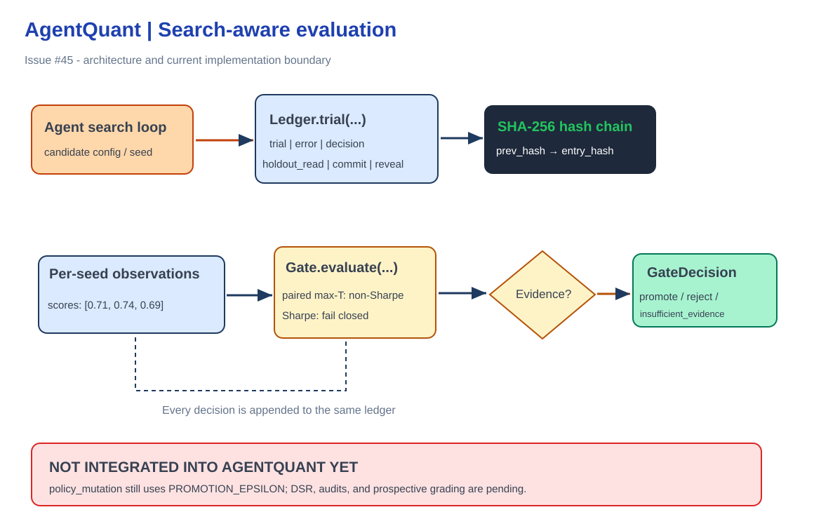

# agentquant-gate (foundation)



[Edit this diagram in Excalidraw](docs/architecture.excalidraw). The diagram distinguishes existing capabilities from planned integrations.


Standalone, numpy-only, tamper-evident JSONL experiment ledger and conservative search-aware promotion gate.

This is a **partial implementation** of AgentQuant issue #45. The paired max-T bootstrap gate is wired into the bounded self-improvement loop (`src/agent/policy_mutation.py`), which scores each validation cell by holdout net return.

Sharpe-valued metrics are promoted only when each trial records `n_obs` (bars per score) and the candidate clears a deflated-Sharpe hurdle (`agentquant_gate.dsr`). Without `n_obs` the gate returns `insufficient_evidence`. `scripts/benchmark_gate_options.py` compares the options on a synthetic known-truth simulation (1,000 runs per cell): net return with the bootstrap and Sharpe with the bootstrap both hold false promotions under 2% at no edge and promote 66% / 65% at a 1.5 Sharpe edge; adding the deflated-Sharpe hurdle on top is more conservative (0.5% / 24%) because the max-T bootstrap already corrects for the search.

Hash chains detect changes relative to a trusted checkpoint; an attacker able to rewrite and rehash the entire file cannot be detected without an externally anchored head hash.

```python
from agentquant_gate import Ledger, Gate
ledger = Ledger("runs/ledger.jsonl")
with ledger.trial(config={"window": 20}, family="experiment", metric="accuracy") as trial:
    trial.record(scores=[0.7, 0.8, 0.75], budget={"usd": 0.08})
ledger.verify()
```

Install: `pip install ./gate`.

Follow-up work: DSR, null/power simulations, all AgentQuant call-site integrations, adapters, and prospective evaluation.
