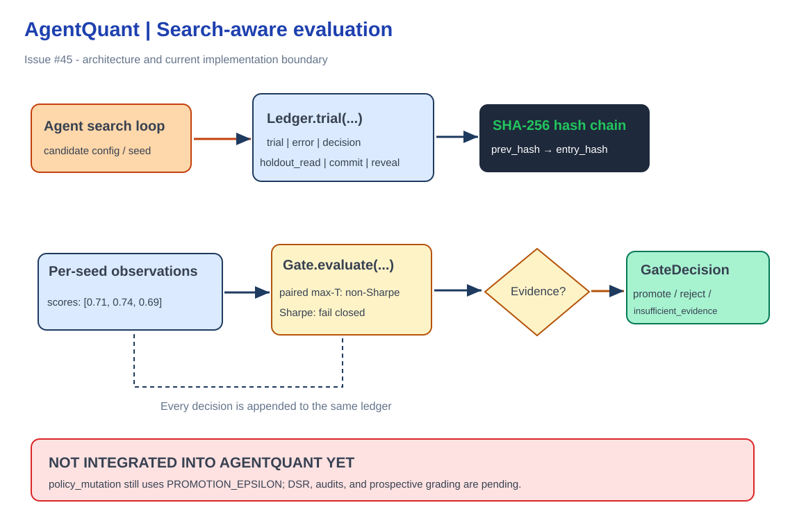

# agentquant-gate (foundation)



[Edit this diagram in Excalidraw](docs/architecture.excalidraw). The diagram distinguishes existing capabilities from planned integrations.


Standalone, numpy-only, tamper-evident JSONL experiment ledger and conservative search-aware promotion gate.

This is a **partial implementation** of AgentQuant issue #45 (Milestone 1). It is **not yet wired into AgentQuant's promotion paths**. Sharpe comparisons deliberately return `insufficient_evidence` until a validated Deflated Sharpe Ratio implementation is added.

Hash chains detect changes relative to a trusted checkpoint; an attacker able to rewrite and rehash the entire file cannot be detected without an externally anchored head hash.

```python
from agentquant_gate import Ledger, Gate
ledger = Ledger("runs/ledger.jsonl")
with ledger.trial(config={"window": 20}, family="experiment", metric="accuracy") as trial:
    trial.record(scores=[0.7, 0.8, 0.75], budget={"usd": 0.08})
ledger.verify()
```

Install: `pip install ./gate`.

Follow-up work: DSR, null/power simulations, all AgentQuant call-site integrations, adapters, and prospective evaluation.
