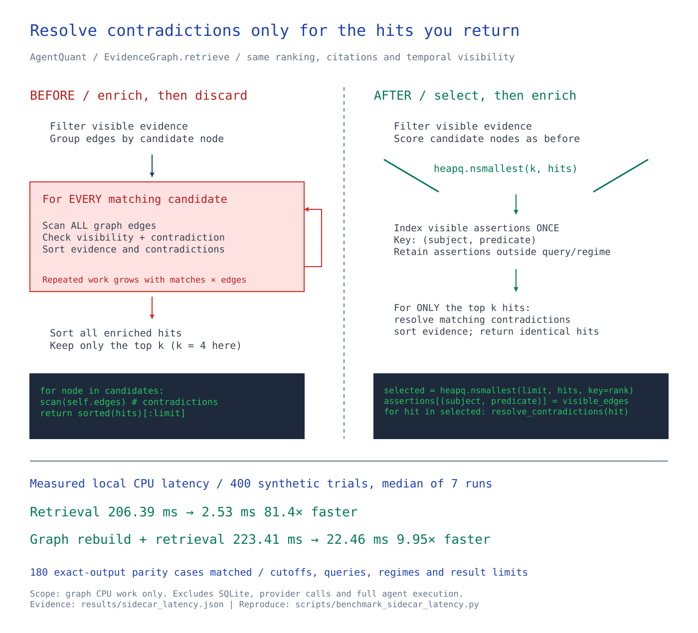

# Faster graph-memory retrieval

The memory sidecar used to resolve contradictions for every matching candidate before keeping just a few hits. It now selects the top hits first and resolves contradictions only for those results.



[Edit the Excalidraw diagram](before_after.excalidraw) · [PNG preview](before_after.png)

## What changed

Before: for every matching node, scan all graph edges for contradictions, sort its evidence, then sort all hits and discard everything beyond the result limit.

After: tokenize the query once, score candidates, select the same top hits with `heapq.nsmallest`, build a query-local index of visible assertions by `(subject, predicate)`, and materialize evidence and contradictions only for selected hits.

The assertion index includes visible evidence outside the query and regime filter. This preserves contradictions that would otherwise disappear. Market and knowledge cutoffs, ranking, citations, and output order remain unchanged.

## Measurement

| Operation | Before | After | Speedup |
|---|---:|---:|---:|
| Retrieval on an existing graph | 206.39 ms | 2.53 ms | 81.4× |
| Graph rebuild + retrieval | 223.41 ms | 22.46 ms | 9.95× |

400 synthetic trials, `query="outcome"`, `limit=4`, median of 7 runs on the same local environment. Baseline: `a6ae7b2c27cdd5331dc5b699e2b85743bb52728e`. Timings are CPU wall time and exclude SQLite access, model calls, and full agent execution. Results vary with hardware, graph size, query selectivity, and result limit.

[Raw results](../../results/sidecar_latency.json) · [Implementation](../../src/memory/graph.py) · [Regression tests](../../tests/test_memory_graph.py)

From the repository root:

```bash
python scripts/benchmark_sidecar_latency.py
```

The benchmark checks exact output equality against the baseline over 180 combinations of queries, cutoffs, regimes, and limits before measuring latency. The focused graph/tool/compaction suite passed 45 tests when this change was recorded.

## Diagram provenance

Created using [coleam00/excalidraw-diagram-skill](https://github.com/coleam00/excalidraw-diagram-skill), following its layout, palette, and technical-evidence guidance. The editable source is hand-authored Excalidraw JSON. The SVG and PNG are static geometry previews; this environment could not launch the skill's Chromium renderer. No skill files are vendored into AgentQuant.
